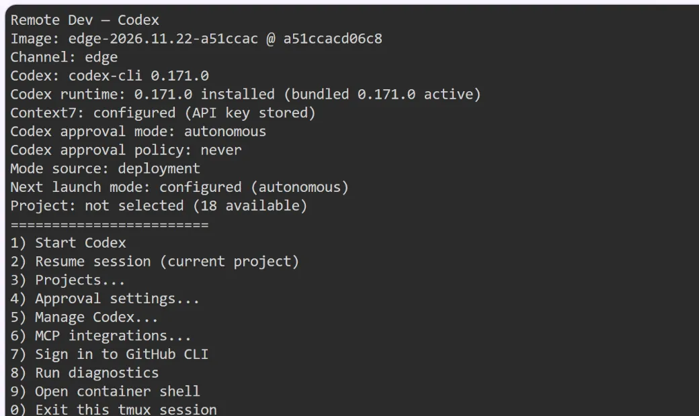
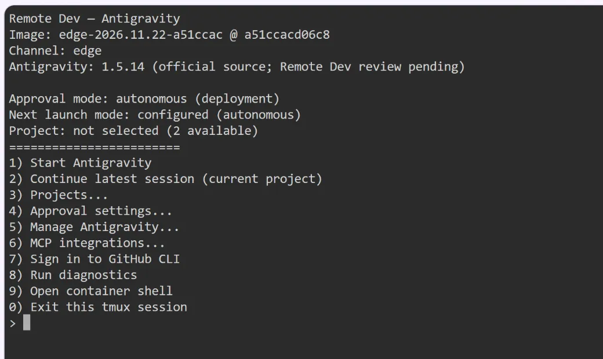

# Remote Dev Containers

**Tu entorno de desarrollo remoto, accesible desde el navegador.** Utiliza Codex —y, opcionalmente, el CLI experimental de Antigravity— en un Docker, NAS o servidor doméstico, sin tener que instalar todas las herramientas en tu ordenador.

[English](README.md) · **Español**  
[Build AMD64](https://github.com/eXPerience83/remote-dev-containers/actions/workflows/build-amd64.yml) · [Versiones publicadas](https://github.com/eXPerience83/remote-dev-containers/releases) · [Changelog](CHANGELOG.md) · [Roadmap](docs/roadmap.md)

> [!IMPORTANT]
> **AMD64 · un usuario · red privada de confianza.** No expongas los terminales web ni el launcher sin contraseña a Internet. Este proyecto comunitario **no está afiliado ni respaldado por OpenAI, Google o Anthropic**. Antigravity es opcional y experimental.

## Así se ve Remote Dev

Capturas reales de TrueNAS SCALE con la imagen Edge del corte de código `v0.3.0` (`edge-2026.11.22-a51ccac`). Se han recortado para facilitar su lectura. Estas pantallas muestran la interfaz, pero **no sustituyen** la aceptación funcional, de persistencia y de seguridad.

**Codex — proyectos, sesiones, permisos, MCP y diagnósticos**



<details>
<summary>Ver también el menú de Antigravity (opcional)</summary>



</details>

## Qué incluye

| | Funcionalidad |
| --- | --- |
| **Acceso desde navegador** | Launcher de navegación y terminales independientes con `ttyd` y `tmux`. |
| **Codex** | CLI de OpenAI incluido en la imagen, Start/Resume por proyecto, autenticación nativa, ajustes de permisos y actualización oficial opcional conservando la versión integrada como alternativa. |
| **Antigravity (experimental)** | Terminal, workspace, configuración y sesiones propios. El CLI oficial de Google se instala **solo cuando el usuario lo solicita**, y no se redistribuye dentro de la imagen. |
| **MCP** | MCP oficial de documentación de OpenAI para Codex, Context7 alojado y opcional (autenticación separada por rol), y Playwright MCP con Chromium fijado en la imagen. |
| **Herramientas de desarrollo** | Git/GitHub CLI, Python, Node.js, uv, mise y otras utilidades fijadas para desarrollo y validación. |
| **Datos persistentes** | Proyectos, credenciales, configuración e historial de conversaciones separados por rol y montados desde el host. Recrear el contenedor no debería eliminarlos. |

La referencia recomendada para ejecutar los servicios es **una única imagen**: `ghcr.io/experience83/remote-dev`. `remote-dev-base` es un paquete de capas de compilación; **no** es otra aplicación que debas desplegar.

## Cómo está organizado

```text
Navegador en LAN de confianza / red privada
  ├── :7680  Launcher             solo navegación; sin secretos de agentes
  ├── :7681  Terminal Codex       con contraseña → ttyd/tmux → Codex
  └── :7682  Terminal Antigravity con contraseña → ttyd/tmux → AGY (opcional)
                                                ↓
                                   Proyectos y estado privados por rol
```

El launcher **no es** una pasarela de autenticación: cada terminal de agente protege su propio acceso. Seleccionar proyecto establece el directorio de trabajo; **no** aísla proyectos hermanos montados en el mismo rol. Más información en [arquitectura](docs/architecture.md) y [seguridad](docs/security.md).

## Instalar en TrueNAS SCALE

**[Manual completo de instalación y actualización en TrueNAS](docs/truenas-install.es.md)** ([English](docs/truenas-install.md)). El archivo canónico para la Custom App es [`compose/truenas.yml`](compose/truenas.yml); aquí no duplicamos un YAML que pueda quedarse desactualizado.

1. Crea un dataset persistente, por ejemplo `Pool1/remote-dev`, con la política revisada de permisos **Generic/POSIX**. En una actualización, no sobrescribas el dataset existente.
2. Utiliza scripts y Compose **de la misma revisión de código que la imagen elegida**. Ejecuta inicialización, preflight y auditoría de ACL de solo lectura siguiendo el manual.
3. Revisa las rutas del host y las **IP de escucha de LAN/red privada**; configura valores `WEB_PASSWORD` no vacíos para los terminales habilitados. No abras esos puertos a Internet.
4. Antes de actualizar, conserva la configuración y el digest inmutable anterior para poder retroceder. Despliega una imagen comprobada fijándola por **digest OCI**, no confiando solo en un tag mutable.
5. Abre el launcher, selecciona un proyecto y utiliza **Start** o **Resume/Continue** en el menú correspondiente.

**Si ya lo tenías instalado:** conserva los montajes de proyectos, estado y credenciales. Recrear el contenedor termina los procesos de Codex y `tmux`; puedes reanudar el historial persistente con Resume/Continue, pero **los comandos interrumpidos no se reinician automáticamente**.

## Versiones y canales

| Canal | Uso |
| --- | --- |
| `edge` / `edge-amd64` | Imagen experimental para validación; cambia con frecuencia. |
| `stable` / `latest` | Etiquetas estables previstas: la política del proyecto es actualizarlas solo mediante publicaciones autorizadas y verificadas de forma independiente; aún no se han confirmado los controles frente a publicadores históricos. |
| `vMAJOR.MINOR.PATCH` | Versión estable etiquetada tras las pruebas y aceptación del publicador del tag exacto. |

La **versión del código**, la identidad de la imagen Edge, el **digest del índice OCI** y el digest de su manifiesto AMD64 son identificadores distintos. Subir la versión del código no publica automáticamente Stable. Consulta las [versiones realmente publicadas](https://github.com/eXPerience83/remote-dev-containers/releases) y el [procedimiento de publicación](docs/releases.es.md). No des por bloqueados los publicadores históricos hasta verificar las reglas de tags y las reejecuciones de workflows.

## Privacidad y seguridad

- Context7 es un **servicio externo opcional de Upstash**. Las consultas generadas por las herramientas y ciertos metadatos pueden salir del NAS: evita secretos, código privado y datos personales. Consulta [terceros](third_party/optional-agents.md) y [configuración Context7](docs/context7-codex.es.md).
- Antigravity sigue siendo **experimental** y sujeto a las condiciones de Google. Remote Dev muestra su CLI interactivo oficial en un terminal privado; no presume de respaldo ni de autorización especial del proveedor. [Lee sus limitaciones](docs/antigravity-remote-terminal-policy.es.md).
- Cada contenedor de agente puede acceder a **sus propios montajes** de proyectos y estado. El launcher no recibe credenciales de agentes ni el socket Docker. Remote Dev **no** es un servicio multiusuario ni está diseñado para exposición pública.

## Guías y colaboración

| Tema | Documentación |
| --- | --- |
| Uso diario, proyectos y sesiones | [Guía de uso](docs/user-guide.es.md) · [English](docs/user-guide.md) |
| TrueNAS y recuperación | [Instalación TrueNAS](docs/truenas-install.es.md) · [English](docs/truenas-install.md) |
| Arquitectura y seguridad | [Arquitectura](docs/architecture.md) · [Seguridad](docs/security.md) · [ACL del host](docs/truenas-acl-contract.es.md) |
| Codex, Context7 y Playwright | [Actualizaciones Codex](docs/codex-runtime-updates.es.md) · [Context7](docs/context7-codex.es.md) · [Seguridad del navegador](docs/security.md) |
| Versiones y estado del proyecto | [Publicación](docs/releases.es.md) · [Changelog](CHANGELOG.md) · [Estado](PROJECT_STATUS.md) · [Roadmap](docs/roadmap.md) |
| Mejoras y problemas | [Contribuir](CONTRIBUTING.md) · [Abrir un issue](https://github.com/eXPerience83/remote-dev-containers/issues) · [Política de seguridad](SECURITY.md) |

El código del proyecto utiliza licencia [Apache-2.0](LICENSE). Las herramientas de terceros y el software opcional de proveedores mantienen **sus propias licencias, avisos y condiciones**. Consulta [`NOTICE`](NOTICE) y [`third_party/`](third_party/).
