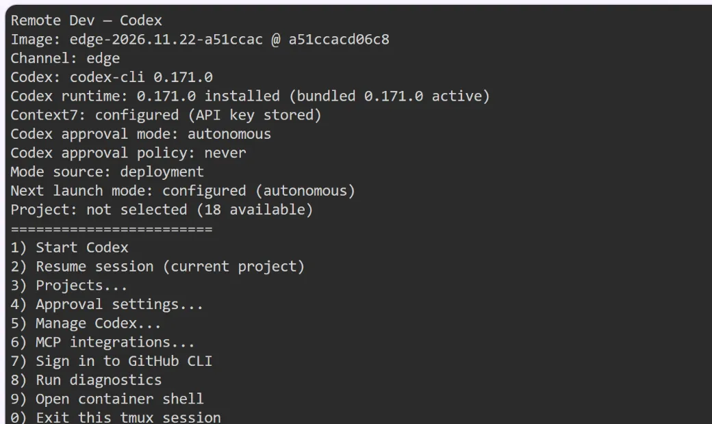
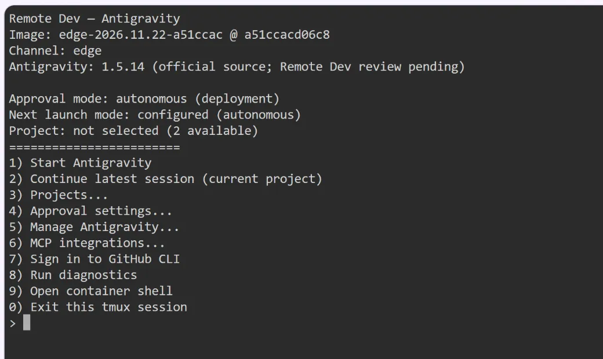

# Remote Dev Containers

**A self-hosted coding workspace you can open from a browser.** Run Codex—and optionally the experimental Antigravity CLI—on a remote Docker host, NAS, or homelab instead of installing the whole development environment on your own computer.

**English** · [Español](README.es.md)  
[Build AMD64](https://github.com/eXPerience83/remote-dev-containers/actions/workflows/build-amd64.yml) · [Releases](https://github.com/eXPerience83/remote-dev-containers/releases) · [Changelog](CHANGELOG.md) · [Roadmap](docs/roadmap.md)

> [!IMPORTANT]
> **AMD64 · single user · trusted private network.** Do not expose the web terminals or the password-free launcher to the public Internet. This community project is **not affiliated with or endorsed by OpenAI, Google, or Anthropic**. Antigravity is optional and experimental.

## See it in action

Real TrueNAS SCALE screenshots of the `v0.3.0` source-cut Edge image (`edge-2026.11.22-a51ccac`). Cropped for readability; these screens show the interfaces, **not** a substitute for full functional, persistence, or security acceptance.

**Codex — projects, sessions, approval modes, MCPs, and diagnostics**



<details>
<summary>See the optional Antigravity menu</summary>



</details>

## What you get

| | Included behavior |
| --- | --- |
| **Open from a browser** | A small launcher opens independent terminal endpoints, backed by `ttyd` and `tmux`. |
| **Codex** | Bundled OpenAI Codex CLI, project-scoped Start/Resume, native login, approval settings, and an optional official CLI update path with bundled fallback. |
| **Antigravity (experimental)** | Separate terminal, workspace, configuration and sessions; the official Google CLI is installed **only when explicitly requested**, not redistributed in the image. |
| **MCP tooling** | Official OpenAI Docs MCP for Codex, optional hosted Context7 (with separate per-role authentication), and bundled Playwright MCP with a pinned Chromium browser. |
| **Development tools** | Git/GitHub CLI, Python, Node.js, uv, mise and other pinned development and validation utilities. |
| **Persistent state** | Role-specific workspaces, CLI credentials, settings and conversation history backed by host mounts; container recreation does not intentionally wipe them. |

The recommended runtime is **one** image reference, `ghcr.io/experience83/remote-dev`, reused by the enabled services. `remote-dev-base` is a build-layer package, **not** a second application the operator must deploy.

## How the stack works

```text
Browser on trusted LAN / private mesh
  ├── :7680  Launcher             navigation only; no agent secrets
  ├── :7681  Codex terminal       password-protected → ttyd/tmux → Codex
  └── :7682  Antigravity terminal password-protected → ttyd/tmux → AGY (optional)
                                                ↓
                                   Private workspace and state per role
```

The launcher **is not** an authentication gateway: Codex and Antigravity protect their own endpoints. Project selection sets a working directory; it does **not** sandbox sibling projects mounted into the same role. See the [architecture](docs/architecture.md) and [security model](docs/security.md).

## Install on TrueNAS SCALE

**[Follow the complete TrueNAS installation and update guide](docs/truenas-install.md)** ([Español](docs/truenas-install.es.md)). The source of truth for the Custom App configuration is [`compose/truenas.yml`](compose/truenas.yml), not a copied YAML in this README.

1. Create a persistent root dataset such as `Pool1/remote-dev`, with the reviewed **Generic/POSIX** permissions policy; never overwrite an existing dataset during an update.
2. Use the scripts and Compose definition **from the same source revision as the selected image**. Initialize the layout, run preflight and the read-only host ACL audit as described in the guide.
3. Review host paths and **LAN/private-mesh bind IPs**, configure nonempty `WEB_PASSWORD` values for enabled agent endpoints, and keep the launcher/terminals off the public Internet.
4. For updates, retain the previous immutable image digest and configuration for rollback. Pin the selected tested image by **OCI digest**, rather than trusting a mutable tag during deployment.
5. Open the launcher, select a project, then choose **Start** or **Resume/Continue** in the corresponding agent menu.

**Existing installations:** keep your project, agent state and credential mounts. Recreating the container ends running CLI and `tmux` processes; preserved conversation history can be selected using Resume/Continue, but an interrupted command **does not automatically restart**.

## Releases and support

| Channel | Purpose |
| --- | --- |
| `edge` / `edge-amd64` | Experimental image for validation; may change frequently. |
| `stable` / `latest` | The same intended stable channel, updated only through an authorized, separately tested release. |
| `vMAJOR.MINOR.PATCH` | Versioned stable release after the exact-tag publisher and acceptance gates complete. |

A **source version**, an Edge build label, the **OCI index digest**, and its AMD64 child digest are different identifiers. A new source version does not automatically publish Stable. [See current published releases](https://github.com/eXPerience83/remote-dev-containers/releases) and the [release procedure](docs/releases.md) for actual status. Do not assume old tag-based publishers are prevented from modifying aliases until repository tag and workflow re-run controls are verified.

## Privacy and safety

- Context7 is an **optional hosted Upstash service**. Tool-generated documentation queries and metadata can leave the host; do not send secrets, private code or personal information. Review [third-party considerations](third_party/optional-agents.md) and [Context7 setup](docs/context7-codex.md).
- Antigravity remains **experimental** and subject to its provider's terms. Remote Dev presents its official interactive CLI through a private terminal; it does not claim an endorsement or special authorization. [Read the documented limits](docs/antigravity-remote-terminal-policy.md).
- Agent containers have access to their **own mounted** workspaces and state. The launcher does not mount agent secrets or a Docker socket. Remote Dev is **not** a multi-tenant platform or a public Internet-facing service.

## Documentation and contributing

| Topic | Guide |
| --- | --- |
| Daily use, projects and sessions | [User guide](docs/user-guide.md) · [Español](docs/user-guide.es.md) |
| TrueNAS setup and rollback | [TrueNAS installation](docs/truenas-install.md) · [Español](docs/truenas-install.es.md) |
| Architecture and security | [Architecture](docs/architecture.md) · [Security](docs/security.md) · [Host ACLs](docs/truenas-acl-contract.md) |
| Codex, Context7 and Playwright | [Codex updates](docs/codex-runtime-updates.md) · [Context7](docs/context7-codex.md) · [Browser security](docs/security.md) |
| Releases and project status | [Release guide](docs/releases.md) · [Changelog](CHANGELOG.md) · [Project status](PROJECT_STATUS.md) · [Roadmap](docs/roadmap.md) |
| Help improve the project | [Contributing](CONTRIBUTING.md) · [Report an issue](https://github.com/eXPerience83/remote-dev-containers/issues) · [Security policy](SECURITY.md) |

Project code is licensed under [Apache-2.0](LICENSE); bundled third-party tools and optional vendor software have their **own** licenses, notices and terms. See [`NOTICE`](NOTICE) and [`third_party/`](third_party/).